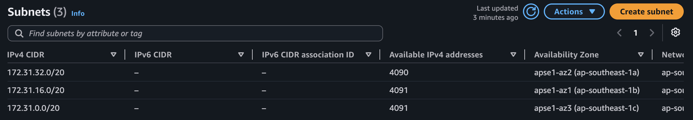
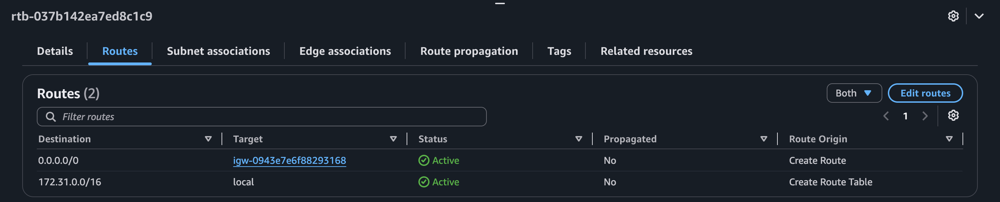
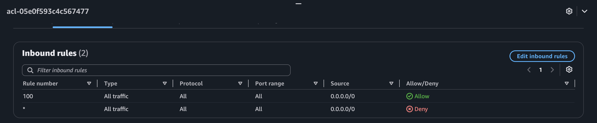
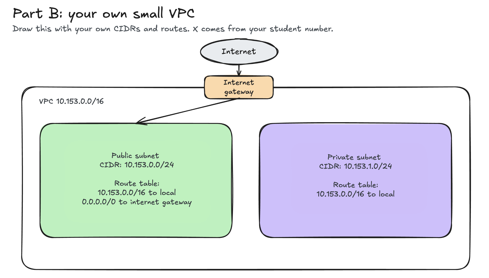

# Assignment 2 Submission

## About me

- GitHub username: DietherUrdas
- Section: IV-CCSAD
- IAM user name that I signed in with: ccsad-g02
- X: 153

---

## Part A. Explore

### A1. The VPC

Default VPC IPv4 CIDR:

172.31.0.0/16

Number of addresses in that CIDR:

65,536

### A2. The subnets

| Availability Zone | IPv4 CIDR |
| --- | --- |
| apse1-az2 (ap-southeast-1a) | 172.31.32.0/20 |
| apse1-az1 (ap-southeast-1b) | 172.31.16.0/20 |
| apse1-az3 (ap-southeast-1c) | 172.31.0.0/20 |

Screenshot 1. Save it as `screenshot-1-subnets.png` in your folder. The image line below shows it.

### A3. Available addresses

Available IPv4 addresses in each subnet:

ap-southeast-1a: 4,090 
ap-southeast-1b: 4,091 
ap-southeast-1c: 4,091

Why is the number lower than 4,096?

AWS reserves 5 IP addresses in every subnet for internal networking tasks (network address, VPC router, DNS mapping, future reservation, and broadcast), leaving 4,091 usable addresses in a /20 subnet.

What uses the missing address in the subnet with the lowest number?

An active network interface (ENI) attached to a running EC2 instance inside that subnet.

### A4. The route table

| Destination | Target |
| --- | --- |
| 172.31.0.0/16 | local |
| 0.0.0.0/0 | igw-... |

Screenshot 2. Save it as `screenshot-2-routes.png` in your folder. The image line below shows it.

### A5. Public or private

Are the default subnets public or private? Which route proves it?

They are public subnets. The route `0.0.0.0/0` targeting the internet gateway (`igw-...`) proves that the subnets have an active route to send and receive public internet traffic.

### A6. The internet gateway

State of the internet gateway:

Attached

What happens to the default subnets if the gateway is detached?

All subnets lose direct internet connectivity because the `0.0.0.0/0` route no longer has an active target gateway, preventing outside traffic from entering or leaving.

### A7. NAT gateways

Number of NAT gateways:

0

Can a server in a new private subnet download updates? Why?

No. A private subnet does not have a direct route to an internet gateway, and without a NAT gateway in a public subnet to handle outbound translations, instances cannot establish connections to update servers on the internet.

### A8. The network ACL

| Rule number | Source | Allow or Deny |
| --- | --- | --- |
| 100 | 0.0.0.0/0 | Allow |
| * | 0.0.0.0/0 | Deny |

How is a network ACL different from a security group?

A network ACL operates as a stateless firewall at the subnet level that evaluates both allow and deny rules in strict numerical order. A security group operates as a stateful firewall at the resource level that evaluates allow rules only.

Screenshot 3. Save it as `screenshot-3-network-acl.png` in your folder. The image line below shows it.

### A9. The default security group

Inbound rule (type and source):

All traffic, source: sg-... (the default security group itself)

Which resources can send traffic to an instance that uses it?

Only resources assigned to the exact same default security group can send inbound traffic.

---

## Part B. Prepare

### B1. Plan two subnets

- Public subnet CIDR: 10.153.0.0/24
- Private subnet CIDR: 10.153.1.0/24

### B2. Route tables

Route table of the public subnet:

| Destination | Target |
| --- | --- |
| 10.153.0.0/16 | local |
| 0.0.0.0/0 | internet gateway |

Route table of the private subnet:

| Destination | Target |
| --- | --- |
| 10.153.0.0/16 | local |

### B3. My VPC diagram

Tool used (Excalidraw, draw.io, Lucidchart, or paper):

Excalidraw

Save your diagram as `vpc-diagram.png` in your folder. The image line below shows it.

### B4. Predict a change

Can you still open the web page from your laptop? Why?

No. Removing the `0.0.0.0/0` route deletes the path to the internet, so response packets from the server cannot route back to your laptop.

Can the instance still reach another instance in the VPC? Why?

Yes. Communication between instances inside the VPC relies on the `10.153.0.0/16` local route, which remains active regardless of internet routes.

### B5. Place a database

Which subnet gets the database? Why?

The private subnet. Databases store sensitive data and should never be directly accessible from the public internet; web servers in the public subnet can connect to it internally using the local route.

### B6. My question about VPCs

What is your question, and what made you think of it?

How do VPC Endpoints allow private subnet instances to securely access AWS S3 buckets without needing a NAT Gateway or public routing? I thought of this because NAT Gateways incur additional hourly costs while routing traffic externally.
