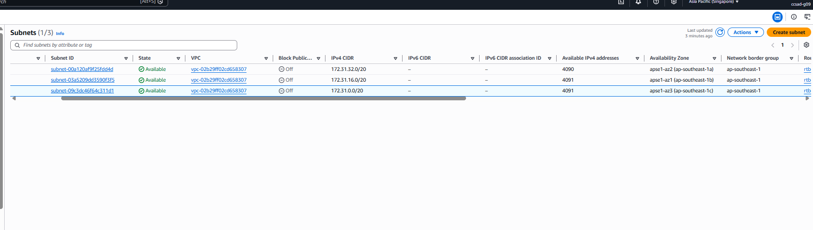

# Assignment 2 Submission

<!--
How to use this template:

1. Copy this file to submissions/assignment-2/<your-github-username>/submission.md
2. Replace every answer placeholder with your own answer. Delete the angle brackets too.
3. Save your four images in the same folder, with the exact file names below.
4. Do not write your full name or your student number in this file.
-->

## About me

- GitHub username: Jsmnt
- Section: IV-CCSAD
- IAM user name that I signed in with: ccsad-g09
- X: 132

---

## Part A. Explore

### A1. The VPC

Default VPC IPv4 CIDR:

172.31.0.0/16

Number of addresses in that CIDR:

65,536

### A2. The subnets

| Availability Zone | IPv4 CIDR |
| --- | --- |
| apse1-az2 (ap-southeast-1a) | 172.31.32.0/20 |
| apse1-az1 (ap-southeast-1b) | 172.31.16.0/20 |
| apse1-az3 (ap-southeast-1c) | 172.31.0.0/20 |

Screenshot 1. Save it as `screenshot-1-subnets.png` in your folder. The image line below shows it.

### A3. Available addresses

Available IPv4 addresses in each subnet:

4,091

Why is the number lower than 4,096?

AWS reserves five IP addresses in every subnet: the first four addresses and the last address.

What uses the missing address in the subnet with the lowest number?

A resource within the network interface is assigned an IP address. This can include an instance from Lab 2, even if the instance is stopped, as stopped instances retain their assigned address.

### A4. The route table

| Destination | Target |
| --- | --- |
| 0.0.0.0/0 | igw-0943e7e6f88293168 |
| 172.31.0.0/16 | local |

Screenshot 2. Save it as `screenshot-2-routes.png` in your folder. The image line below shows it.

### A5. Public or private

Are the default subnets public or private? Which route proves it?

The subnets are public, and the proof is the 0.0.0.0/0 → igw-0943e7e6f88293168 route.

### A6. The internet gateway

State of the internet gateway:

Attached

What happens to the default subnets if the gateway is detached?

Without the 0.0.0.0/0 route, there would be no destination for internet-bound traffic, causing the subnets to lose internet connectivity in both directions. As a result, they would effectively become private subnets, although communication between the subnets through the local route would continue to work.

### A7. NAT gateways

Number of NAT gateways:

0

Can a server in a new private subnet download updates? Why?

No. A private subnet does not have a route to the Internet Gateway, nor does it have a NAT Gateway available to handle its outbound traffic.

### A8. The network ACL

| Rule number | Source | Allow or Deny |
| --- | --- | --- |
| 100 | 0.0.0.0/0 | Allow |
| * | 0.0.0.0/0 | Deny |

How is a network ACL different from a security group?

A NACL operates at the subnet level, supports both allow and deny rules, is stateless, and evaluates rules in numerical order. In contrast, a security group operates at the resource level, allows only permitted traffic, and is stateful.

Screenshot 3. Save it as `screenshot-3-network-acl.png` in your folder. The image line below shows it.

### A9. The default security group

Inbound rule (type and source):

sgr-0b795189f3efb993c
Type: All traffic
Soruce: sg-0c5b6d4081cf0a534

Which resources can send traffic to an instance that uses it?

only resources that also use this same security group can send traffic in.

---

## Part B. Prepare

### B1. Plan two subnets

- Public subnet CIDR: 10.132.0.0/24
- Private subnet CIDR: 10.132.1.0/24

### B2. Route tables

Route table of the public subnet:

| Destination | Target |
| --- | --- |
| 10.132.0.0/16 | local |
| 0.0.0.0/0 | internet gateway |

Route table of the private subnet:

| Destination | Target |
| --- | --- |
| 10.132.0.0/16 | local |

### B3. My VPC diagram

Tool used (Excalidraw, draw.io, Lucidchart, or paper):

Excalidraw

Save your diagram as `vpc-diagram.png` in your folder. The image line below shows it.

### B4. Predict a change

Can you still open the web page from your laptop? Why?

No. A public IP address and an open security group are not enough. Without a route connecting the subnet to the Internet Gateway, network traffic cannot reach the internet.

Can the instance still reach another instance in the VPC? Why?

Yes. The local route remains active and allows communication between all subnets within the VPC.

### B5. Place a database

Which subnet gets the database? Why?

It belongs in the private subnet because it has no route to the Internet Gateway, preventing direct access from the internet. Only application servers within the VPC should be able to communicate with it.

### B6. My question about VPCs

What is your question, and what made you think of it?

What happens if two VPCs with overlapping CIDR ranges need to connect? This made me wonder how AWS handles routing when both VPCs use the same IP address ranges.

Another question is: How do you choose the appropriate VPC size before knowing how much the application will grow?

Lastly, can a subnet be resized after it has already been created, or would you need to create a new subnet with a different CIDR range?
