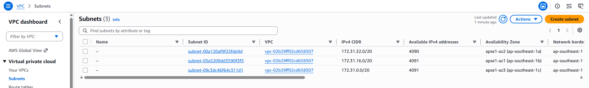
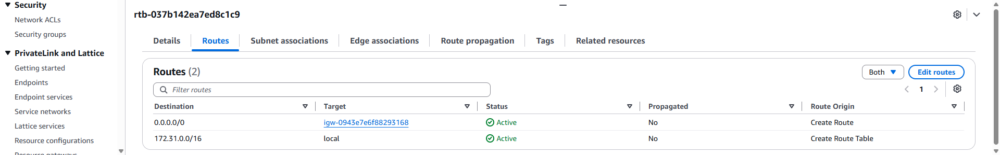
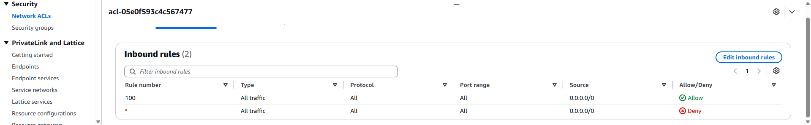
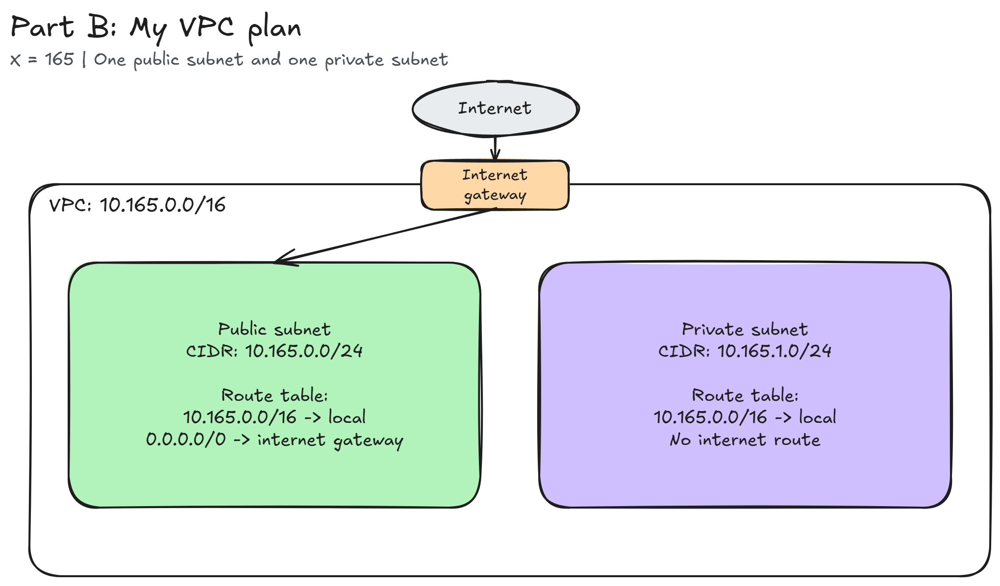

# Assignment 2 Submission

<!--
How to use this template:

1. Copy this file to submissions/assignment-2/<your-github-username>/submission.md
2. Replace every answer placeholder with your own answer. Delete the angle brackets too.
3. Save your four images in the same folder, with the exact file names below.
4. Do not write your full name or your student number in this file.
-->

## About me

- GitHub username: Tajarros-Zed
- Section: IV-CCSAD
- IAM user name that I signed in with: `ccsad-g03`
- X: 165

---

## Part A. Explore

### A1. The VPC

Default VPC IPv4 CIDR:

`172.31.0.0/16`

Number of addresses in that CIDR:

65,536 IPv4 addresses.

### A2. The subnets

| Availability Zone | IPv4 CIDR |
| --- | --- |
| `ap-southeast-1a` | `172.31.32.0/20` |
| `ap-southeast-1b` | `172.31.16.0/20` |
| `ap-southeast-1c` | `172.31.0.0/20` |

Screenshot 1: the subnet list in the Singapore Region.

### A3. Available addresses

Available IPv4 addresses in each subnet:

| Availability Zone | IPv4 CIDR | Available IPv4 addresses |
| --- | --- | --- |
| `ap-southeast-1a` | `172.31.32.0/20` | 4,090 |
| `ap-southeast-1b` | `172.31.16.0/20` | 4,091 |
| `ap-southeast-1c` | `172.31.0.0/20` | 4,091 |

Why is the number lower than 4,096?

AWS keeps five addresses in each subnet for its own use. A `/20` has 4,096 addresses, so 4,091 are available before any resources use addresses. The subnet in `ap-southeast-1a` has one more address in use, leaving 4,090.

What uses the missing address in the subnet with the lowest number?

The subnet `172.31.32.0/20` has one fewer available address than the other two. This means one extra private IPv4 address is allocated to a network interface, such as the interface of an EC2 instance. The subnet list does not show which resource owns it, so I cannot identify the exact instance from this screenshot.

### A4. The route table

| Destination | Target |
| --- | --- |
| `172.31.0.0/16` | `local` |
| `0.0.0.0/0` | `igw-...` |

Screenshot 2: the two active routes of the default VPC route table.

### A5. Public or private

Are the default subnets public or private? Which route proves it?

They are public subnets. The route `0.0.0.0/0` points to the internet gateway, `igw-...`, which gives them a path to the internet. An instance still needs a public IP address and firewall rules that allow the traffic.

### A6. The internet gateway

State of the internet gateway:

Attached.

What happens to the default subnets if the gateway is detached?

The subnets lose their direct path to the internet because the internet gateway route no longer has a working target. Traffic inside the VPC can still use the local route, as long as the firewall rules allow it.

### A7. NAT gateways

Number of NAT gateways:

0. The console showed "No NAT gateways found".

Can a server in a new private subnet download updates? Why?

No, not with the current setup. A private subnet has no direct route to the internet gateway, and this VPC has no NAT gateway. For internet updates, it would need a NAT gateway in a public subnet and a `0.0.0.0/0` route to that NAT gateway in the private subnet's route table.

### A8. The network ACL

| Rule number | Source | Allow or Deny |
| --- | --- | --- |
| 100 | `0.0.0.0/0` | Allow |
| `*` | `0.0.0.0/0` | Deny |

How is a network ACL different from a security group?

A network ACL controls traffic for a whole subnet, has allow and deny rules, and is stateless, so both directions need rules. A security group controls traffic for a resource such as an instance, has allow rules only, and is stateful, so replies to allowed traffic are automatically allowed.

Screenshot 3: the inbound rules of the default network ACL.

### A9. The default security group

Inbound rule (type and source):

Type: All traffic. Source: the `default` security group itself (`sg-...`). The source group ID matched the selected security group's ID.

Which resources can send traffic to an instance that uses it?

Resources that also use this same `default` security group can start connections to the instance through their private IP addresses. Being in the same VPC alone is not enough. The observed inbound rule does not allow new connections from other sources, such as my laptop on the internet.

---

## Part B. Prepare

### B1. Plan two subnets

My VPC CIDR is `10.165.0.0/16`, using X = 165.

- Public subnet CIDR: `10.165.0.0/24`
- Private subnet CIDR: `10.165.1.0/24`

The public subnet ends at `10.165.0.255`. The private subnet starts at the next address, `10.165.1.0`, so the two subnets do not overlap.

### B2. Route tables

Route table of the public subnet:

| Destination | Target |
| --- | --- |
| `10.165.0.0/16` | `local` |
| `0.0.0.0/0` | internet gateway |

Route table of the private subnet:

| Destination | Target |
| --- | --- |
| `10.165.0.0/16` | `local` |

This small plan has no NAT gateway. The private subnet can reach resources inside the VPC, but it has no route to the internet.

### B3. My VPC diagram

Tool used (Excalidraw, draw.io, Lucidchart, or paper):

Excalidraw, using the instructor's starter diagram with my CIDRs and routes filled in.

### B4. Predict a change

Can you still open the web page from your laptop? Why?

No. If `0.0.0.0/0` is removed from the default route table, the instance loses its route to internet addresses, including my laptop. A public IPv4 address alone does not provide a working path for the web connection.

Can the instance still reach another instance in the VPC? Why?

Yes, if the security groups and network ACLs allow the traffic. The local route `172.31.0.0/16` is still there, so instances in the default VPC can still communicate using their private IP addresses.

### B5. Place a database

Which subnet gets the database? Why?

I would put the database in the private subnet, `10.165.1.0/24`. It has no direct route to the internet gateway, so the database is not directly exposed to the internet. I would also use a security group to allow database connections only from the application server.

### B6. My question about VPCs

What is your question, and what made you think of it?

How can I keep a database working if its Availability Zone has a problem? The README says each subnet belongs to one Availability Zone, so I want to know how a database in a private subnet can use another zone as a backup.
