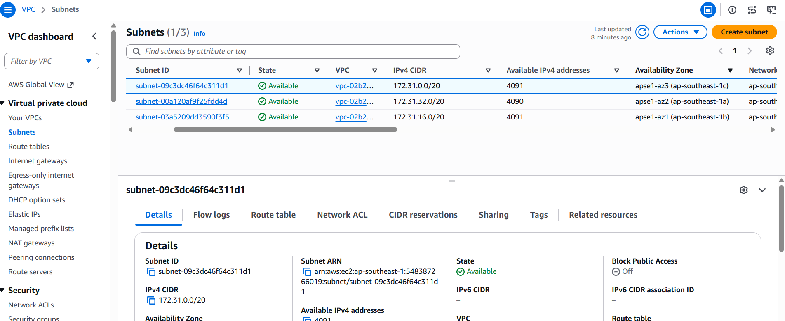
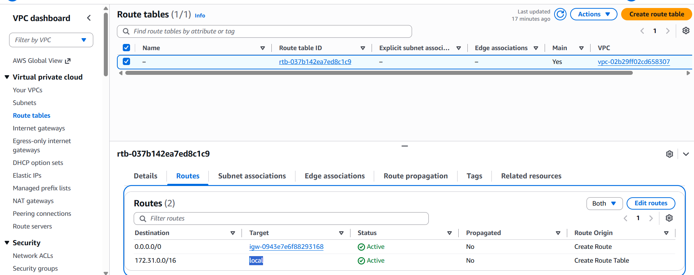
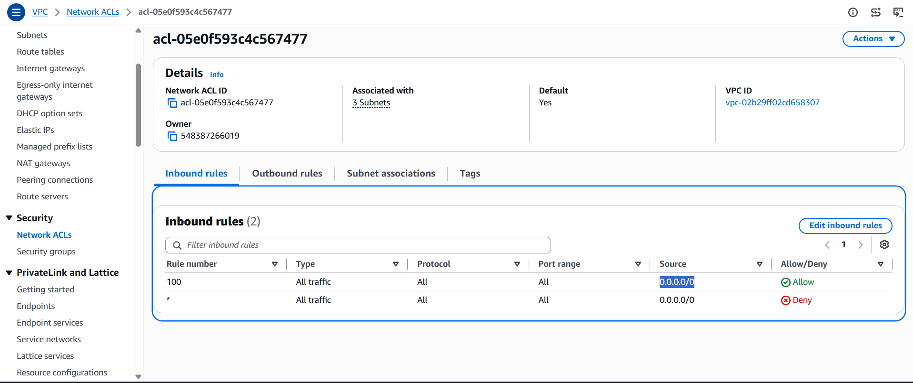
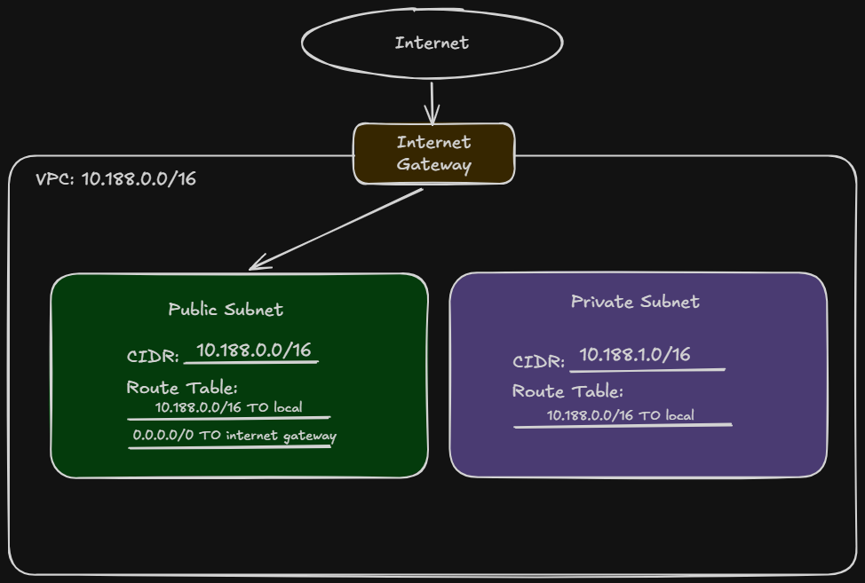

# Assignment 2 Submission

<!--
How to use this template:

1. Copy this file to submissions/assignment-2/<your-github-username>/submission.md
2. Replace every answer placeholder with your own answer. Delete the angle brackets too.
3. Save your four images in the same folder, with the exact file names below.
4. Do not write your full name or your student number in this file.
-->

## About me

- GitHub username: dcchristine
- Section: IV-CCSAD
- IAM user name that I signed in with: ccsad-g03
- X: 188

---

## Part A. Explore

### A1. The VPC

Default VPC IPv4 CIDR:

**`172.31.0.0/16`**

Number of addresses in that CIDR:

**`65,536`**

### A2. The subnets

| Availability Zone | IPv4 CIDR |
| --- | --- |
| apse1-az2 (ap-southeast-1a) | 172.31.32.0/20 |
| apse1-az1 (ap-southeast-1b) | 172.31.16.0/20 |
| apse1-az3 (ap-southeast-1c) | 172.31.0.0/20 |

Screenshot 1. Save it as `screenshot-1-subnets.png` in your folder. The image line below shows it.

### A3. Available addresses

Available IPv4 addresses in each subnet:

**`4091, 	
4090, 
4091`**

Why is the number lower than 4,096?

**A /20 subnet has 4,096 total IPv4 addresses, but AWS reserves 5 addresses for networking purposes, leaving 4,091 available addresses. If the available addresses show 4,090, it means one additional IP address has already been allocated or used.**

What uses the missing address in the subnet with the lowest number?

**The missing address is used by a resource that has already been assigned an IP address in that subnet.**

### A4. The route table

| Destination | Target |
| --- | --- |
| 0.0.0.0/0 | igw-0943e7e6f88293168 |
| 172.31.0.0/16 | local |

Screenshot 2. Save it as `screenshot-2-routes.png` in your folder. The image line below shows it.

### A5. Public or private

Are the default subnets public or private? Which route proves it?

The default subnets are **public** because their route table has a route to the Internet Gateway (`igw-0943e7e6f88293168`). The route that proves this is **`0.0.0.0/0 → igw-0943e7e6f88293168`**.

### A6. The internet gateway

State of the internet gateway:

**Attached**

What happens to the default subnets if the gateway is detached?

**The default subnets will lose their route to the internet, and resources in those subnets will no longer have internet connectivity through the Internet Gateway.**

### A7. NAT gateways

Number of NAT gateways:

**`0 gateways`**

Can a server in a new private subnet download updates? Why?

**No, a server in a new private subnet cannot download updates from the internet because there are **0 NAT gateways**, so the private subnet has no route to the internet.**

### A8. The network ACL

| Rule number | Source | Allow or Deny |
| --- | --- | --- |
| 100 | 0.0.0.0/0| Allow |
| * | 0.0.0.0/0 | Deny |

How is a network ACL different from a security group?

**A network ACL controls traffic at the subnet level, and a security group controls traffic at the instance level.**

Screenshot 3. Save it as `screenshot-3-network-acl.png` in your folder. The image line below shows it.

### A9. The default security group

Inbound rule (type and source):

**Type:** **`All traffic`**  ; **Source:** **`sg-0c5b6d4081cf0a534 / d`** 

Which resources can send traffic to an instance that uses it?

**The inbound rule allows All traffic from the security group sg-0c5b6d4081cf0a534. Therefore, resources that are associated with the same security group can send traffic to an instance using this security group.**

---

## Part B. Prepare

### B1. Plan two subnets

- Public subnet CIDR: **`10.188.0.0/24`**
- Private subnet CIDR: **`10.188.1.0/24`**

### B2. Route tables

Route table of the public subnet:

| Destination | Target |
| --- | --- |
| 10.188.0.0/16 | local |
| 0.0.0.0/0 | internet gateway |

Route table of the private subnet:

| Destination | Target |
| --- | --- |
| 10.188.0.0/16 | local |

### B3. My VPC diagram

Tool used (Excalidraw, draw.io, Lucidchart, or paper): 

**Excalidraw**

Save your diagram as `vpc-diagram.png` in your folder. The image line below shows it.

### B4. Predict a change

Can you still open the web page from your laptop? Why?

**No, because deleting the 0.0.0.0/0 route removes the instance's route to the Internet Gateway, so your laptop can no longer reach it through the internet.**

Can the instance still reach another instance in the VPC? Why?

**Yes, because the local route allows communication between resources within the same VPC.**

### B5. Place a database

Which subnet gets the database? Why?

**I would put the database server in the private subnet (10.188.1.0/24) because databases generally should not be directly accessible from the public internet. It can still communicate with resources in the VPC through the local route.**

### B6. My question about VPCs

What is your question, and what made you think of it?

**Can a private subnet communicate with a public subnet in the same VPC? thought of this because both subnets are inside the same VPC, and  they have different routes, I wondered if they can still communicate with each other.**
