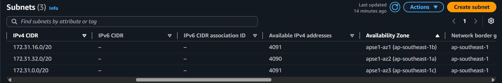
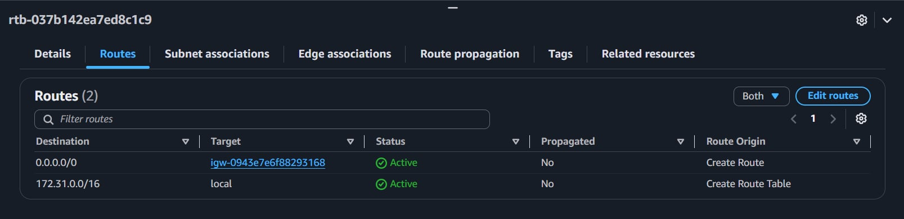
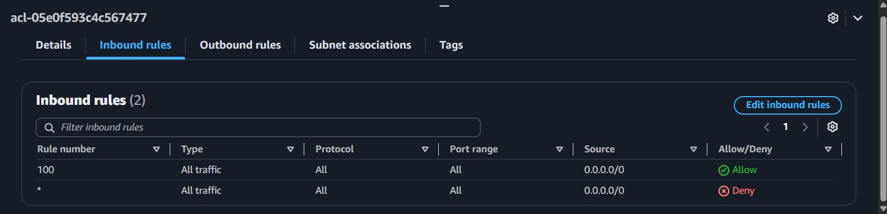
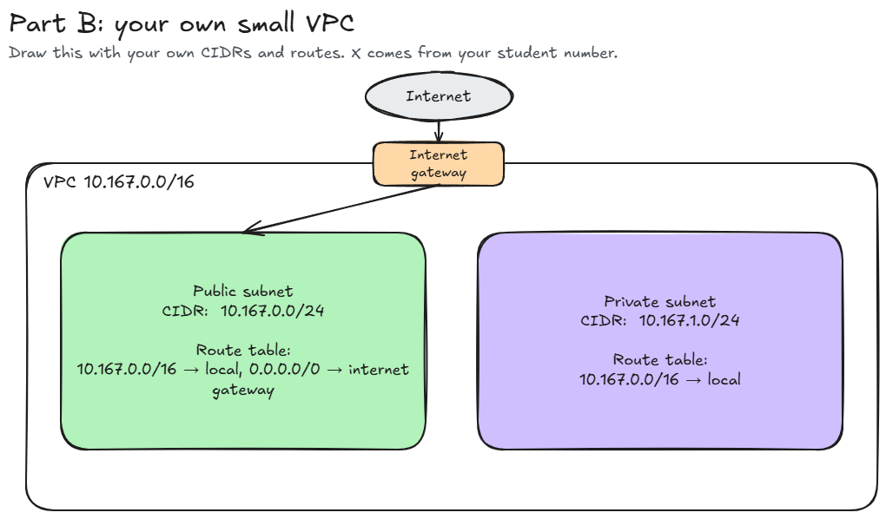

# Assignment 2 Submission

<!--
How to use this template:

1. Copy this file to submissions/assignment-2/<your-github-username>/submission.md
2. Replace every answer placeholder with your own answer. Delete the angle brackets too.
3. Save your four images in the same folder, with the exact file names below.
4. Do not write your full name or your student number in this file.
-->

## About me

- GitHub username: deejay-torres
- Section: IV-CCSAD
- IAM user name that I signed in with: ccsad-g08
- X: 167

---

## Part A. Explore

### A1. The VPC

Default VPC IPv4 CIDR:

172.31.0.0/16

Number of addresses in that CIDR:

65,536

### A2. The subnets

| Availability Zone | IPv4 CIDR |
| --- | --- |
| ap-southeast-1a | 172.31.32.0/20 |
| ap-southeast-1b | 172.31.16.0/20 |
| ap-southeast-1c | 172.31.0.0/20 |

Screenshot 1. Save it as `screenshot-1-subnets.png` in your folder. The image line below shows it.

### A3. Available addresses

Available IPv4 addresses in each subnet:

ap-southeast-1a 4,090 · ap-southeast-1b 4,091 · ap-southeast-1c 4,091

Why is the number lower than 4,096?

A /20 subnet holds 4,096 addresses total, but AWS automatically reserves 5 of them in every subnet for internal purposes, leaving 4,091 usable addresses when nothing is deployed.

What uses the missing address in the subnet with the lowest number?

ap-southeast-1a shows 4,090 instead of 4,091, meaning one more address is taken. A resource — such as an EC2 instance or another network interface — is currently running there and holding one address.

### A4. The route table

| Destination | Target |
| --- | --- |
| 0.0.0.0/0 | igw-... |
| 172.31.0.0/16 | local |

Screenshot 2. Save it as `screenshot-2-routes.png` in your folder. The image line below shows it.

### A5. Public or private

Are the default subnets public or private? Which route proves it?

The default subnets are public. The route 0.0.0.0/0 → igw-... is what makes them public, because it gives those subnets a direct path to the internet through the internet gateway.

### A6. The internet gateway

State of the internet gateway:

Attached

What happens to the default subnets if the gateway is detached?

The 0.0.0.0/0 route loses its target, so all internet traffic stops — instances can't reach the internet and outside users can't reach them. Internal VPC traffic is unaffected because the local route stays in place.

### A7. NAT gateways

Number of NAT gateways:

0

Can a server in a new private subnet download updates? Why?

No. Without a NAT gateway, the private subnet has no way to send outbound traffic to the internet. It only has a local route, so any request going outside the VPC has nowhere to go. A NAT gateway would need to exist in a public subnet first, and the private route table would need a 0.0.0.0/0 entry pointing to it.

### A8. The network ACL

| Rule number | Source | Allow or Deny |
| --- | --- | --- |
| 100 | 0.0.0.0/0 | Allow |
| * | 0.0.0.0/0 | Deny |

How is a network ACL different from a security group?

A network ACL applies to an entire subnet, while a security group is attached to individual resources. Network ACLs support both allow and deny rules and process them in order from the lowest rule number. Security groups only have allow rules. Network ACLs are stateless — return traffic needs its own explicit rule — whereas security groups are stateful, so replies are automatically permitted.

Screenshot 3. Save it as `screenshot-3-network-acl.png` in your folder. The image line below shows it.

### A9. The default security group

Inbound rule (type and source):

All traffic, source is the security group itself (sg-...).

Which resources can send traffic to an instance that uses it?

Only resources that are also assigned the default security group. Since that's the only inbound rule, everything else is blocked by default.

---

## Part B. Prepare

### B1. Plan two subnets

- Public subnet CIDR: 10.167.0.0/24
- Private subnet CIDR: 10.167.1.0/24

### B2. Route tables

Route table of the public subnet:

| Destination | Target |
| --- | --- |
| 10.167.0.0/16 | local |
| 0.0.0.0/0 | internet gateway |

Route table of the private subnet:

| Destination | Target |
| --- | --- |
| 10.167.0.0/16 | local |

### B3. My VPC diagram

Tool used (Excalidraw, draw.io, Lucidchart, or paper):

Excalidraw

Save your diagram as `vpc-diagram.png` in your folder. The image line below shows it.

### B4. Predict a change

Can you still open the web page from your laptop? Why?

No. Removing the 0.0.0.0/0 route cuts the path between the internet and the instance. Traffic from your laptop has no matching route to follow, so the page won't load even if the instance still has a public IP.

Can the instance still reach another instance in the VPC? Why?

Yes. The local route covering the VPC's CIDR is still there, and that's all that's needed for instance-to-instance traffic within the VPC. Deleting the internet gateway route doesn't touch it.

### B5. Place a database

Which subnet gets the database? Why?

The private subnet, 10.167.1.0/24. That subnet has no internet gateway route, so it's unreachable from outside the VPC. Database traffic can only come from other resources inside the VPC through the local route, which is exactly what you want.

### B6. My question about VPCs

What is your question, and what made you think of it?

From the A3 observation — one subnet had 4,090 addresses while the others had 4,091 — I started thinking about what happens to an address when an instance stops. The README says a stopped instance still holds its address, and I want to understand whether that address becomes available again only after the instance is terminated. This matters when planning a small subnet like a /28, where you only have 11 usable addresses to begin with, and a few stopped-but-not-terminated instances could silently eat into that.
