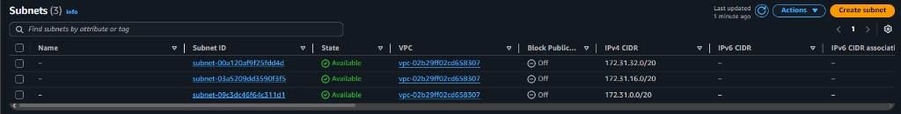
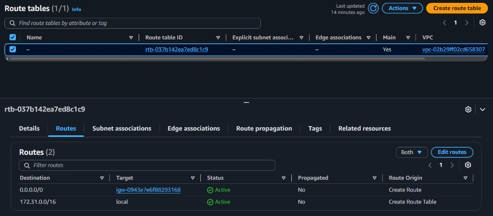
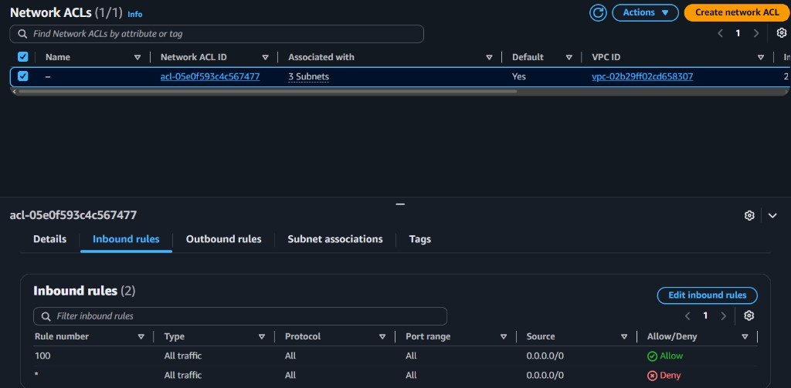
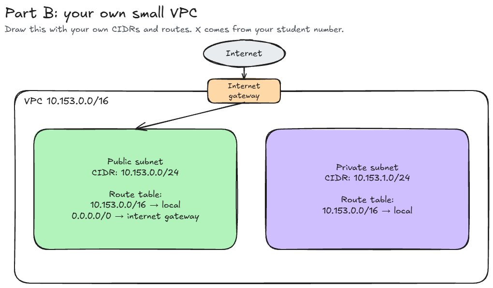

# Assignment 2 Submission

## About me

- GitHub username: h0pSpaint
- Section: IV - CCSAD
- IAM user name that I signed in with: `ccsad-g08`
- X: 153

---

## Part A. Explore

### A1. The VPC

Default VPC IPv4 CIDR:

`172.31.0.0/16`

Number of addresses in that CIDR:

65,536

### A2. The subnets

| Availability Zone | IPv4 CIDR        |
| ----------------- | ---------------- |
| `ap-southeast-1a` | `172.31.32.0/20` |
| `ap-southeast-1b` | `172.31.16.0/20` |
| `ap-southeast-1c` | `172.31.0.0/20`  |

### A3. Available addresses

Available IPv4 addresses in each subnet:

`ap-southeast-1a` 4,090, `ap-southeast-1b` 4,091, `ap-southeast-1c` 4,091.

Why is the number lower than 4,096?

A `/20` subnet has 4,096 addresses, but AWS reserves 5 addresses in every subnet (the first four and the last one). An empty subnet therefore shows 4,096 − 5 = 4,091 available addresses.

What uses the missing address in the subnet with the lowest number?

`ap-southeast-1a` has one address fewer than the others. One network interface holds that address, most likely the network interface of an EC2 instance from the labs. An instance keeps its address even while it is stopped.

### A4. The route table

| Destination     | Target    |
| --------------- | --------- |
| `172.31.0.0/16` | `local`   |
| `0.0.0.0/0`     | `igw-...` |

### A5. Public or private

Are the default subnets public or private? Which route proves it?

Public. The route `0.0.0.0/0` sends traffic to the internet gateway (`igw-...`), so the subnets have a path to the internet.

### A6. The internet gateway

State of the internet gateway:

Attached

What happens to the default subnets if the gateway is detached?

The route `0.0.0.0/0` points to a gateway that is no longer attached, so it has no working target. The default subnets lose their path to the internet and stop being reachable from it, even for instances with a public IP address. Instances can still reach each other through the local route `172.31.0.0/16`.

### A7. NAT gateways

Number of NAT gateways:

0

Can a server in a new private subnet download updates? Why?

No. A private subnet has no route to the internet gateway, and the VPC has no NAT gateway. The private route table would have only the local route, so the server has no path to the internet. It could download updates only after a NAT gateway is added in a public subnet and the private route table gets a route `0.0.0.0/0` to it.

### A8. The network ACL

| Rule number | Source      | Allow or Deny |
| ----------- | ----------- | ------------- |
| 100         | `0.0.0.0/0` | Allow         |
| `*`         | `0.0.0.0/0` | Deny          |

How is a network ACL different from a security group?

A network ACL protects a whole subnet, while a security group protects one resource such as an instance. A network ACL is stateless, has both allow and deny rules, and is checked by rule number from lowest to highest; here rule 100 allows all traffic before the final `*` rule would deny it.

### A9. The default security group

Inbound rule (type and source):

All traffic, from `sg-...` (`default`). The source is the `default` security group itself.

Which resources can send traffic to an instance that uses it?

Only resources that also use the `default` security group. It is the only inbound rule, and a security group blocks everything that no rule allows, so traffic from any other source, including the internet, is blocked.

---

## Part B. Prepare

### B1. Plan two subnets

- Public subnet CIDR: `10.153.0.0/24`
- Private subnet CIDR: `10.153.1.0/24`

### B2. Route tables

Route table of the public subnet:

| Destination     | Target           |
| --------------- | ---------------- |
| `10.153.0.0/16` | `local`          |
| `0.0.0.0/0`     | internet gateway |

Route table of the private subnet:

| Destination     | Target  |
| --------------- | ------- |
| `10.153.0.0/16` | `local` |

### B3. My VPC diagram

Tool used (Excalidraw, draw.io, Lucidchart, or paper):

Excalidraw

### B4. Predict a change

Can you still open the web page from your laptop? Why?

No. My laptop is on the internet, and the route `0.0.0.0/0` to the internet gateway was the only path between the subnet and internet addresses. Without it, the reply from the instance has no route back to my laptop. The public IPv4 address alone is not enough.

Can the instance still reach another instance in the VPC? Why?

Yes. The local route `172.31.0.0/16` is still in the route table, and it connects every subnet in the VPC. Traffic to another instance in the VPC uses this route, not the internet gateway.

### B5. Place a database

Which subnet gets the database? Why?

The private subnet, `10.153.1.0/24`. Its route table has only the local route and no route to the internet gateway, so nobody on the internet can reach the database. The servers in the public subnet can still reach it through the local route.

### B6. My question about VPCs

What is your question, and what made you think of it?

How can I find out which resource is holding an address in a subnet, and does an instance give its address back right away when it is terminated? I thought of it in A3, because `ap-southeast-1a` showed 4,090 available addresses instead of 4,091, but the subnet page did not tell me what was using the missing address.

