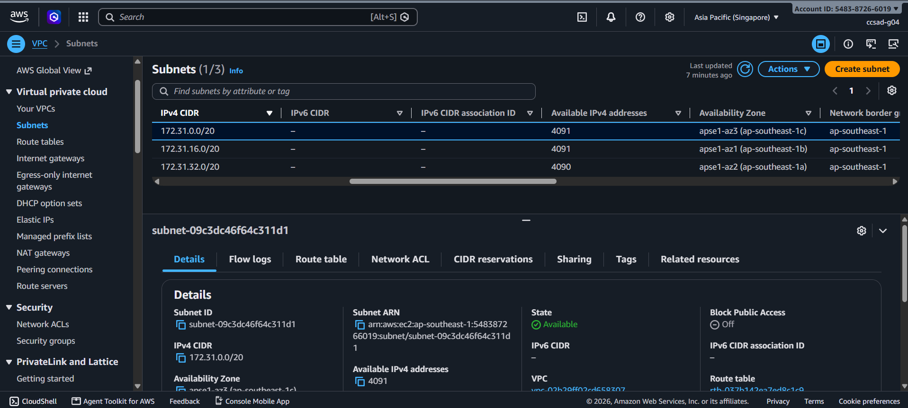
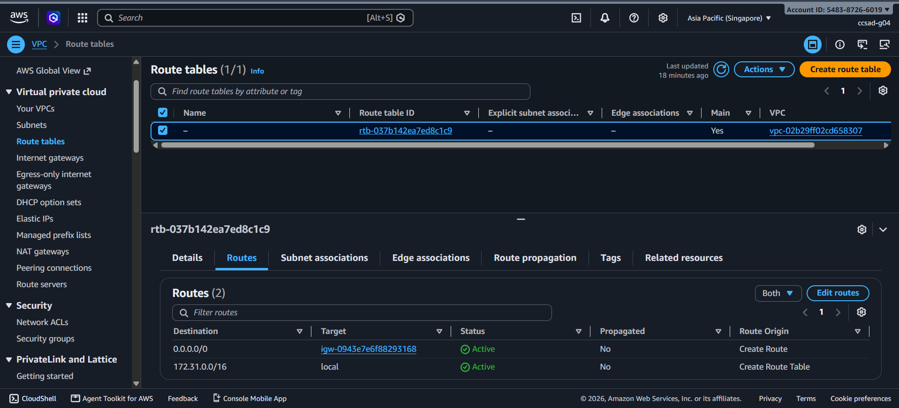
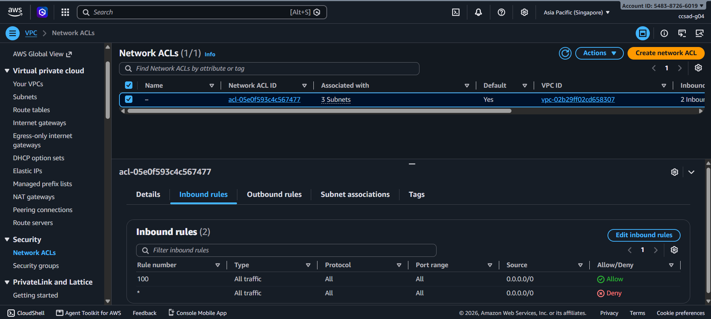
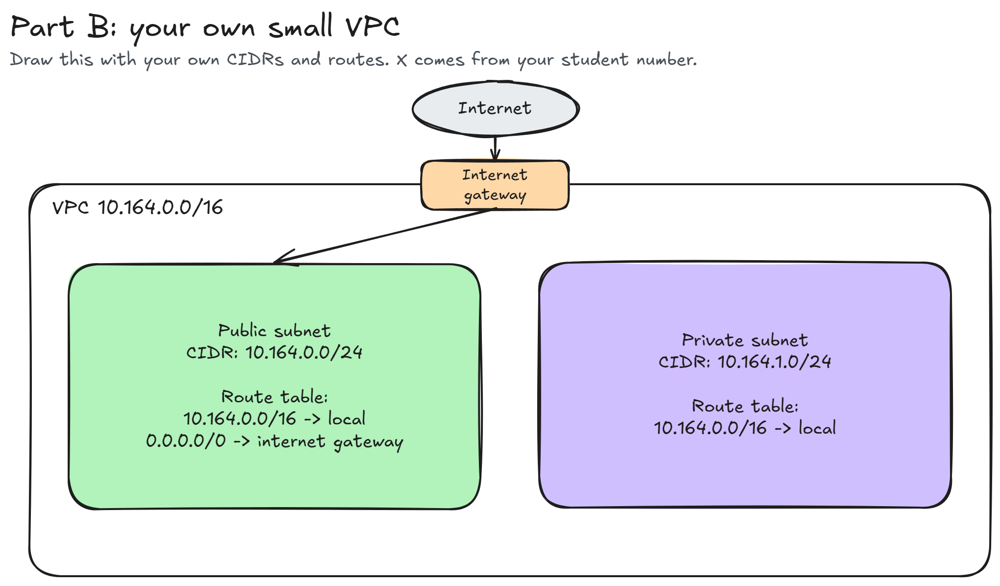

# Assignment 2 Submission

<!--
How to use this template:

1. Copy this file to submissions/assignment-2/<your-github-username>/submission.md
2. Replace every answer placeholder with your own answer. Delete the angle brackets too.
3. Save your four images in the same folder, with the exact file names below.
4. Do not write your full name or your student number in this file.
-->

## About me

- GitHub username: paupausiopau
- Section: CCSAD
- IAM user name that I signed in with: ccsad-g04
- X: 164

---

## Part A. Explore

### A1. The VPC

Default VPC IPv4 CIDR:

172.31.0.0/16

Number of addresses in that CIDR:

65,536

### A2. The subnets

| Availability Zone | IPv4 CIDR |
| --- | --- |
| apse1-az2 (ap-southeast-1a) | 172.31.32.0/20 |
| apse1-az1 (ap-southeast-1b) | 172.31.16.0/20 |
| apse1-az3 (ap-southeast-1c) | 172.31.0.0/20 |

Screenshot 1. Save it as `screenshot-1-subnets.png` in your folder. The image line below shows it.

### A3. Available addresses

Available IPv4 addresses in each subnet:

| 172.31.32.0/20 | 4,090 |
| 172.31.16.0/20 | 4,091 |
| 172.31.0.0/20 | 4,091 |

Why is the number lower than 4,096?

AWS keeps 5 addresses in every subnet (the first four and the last one). We cannot use them. So a /20 subnet has 4,091 usable addresses, not 4,096.

What uses the missing address in the subnet with the lowest number?

An EC2 instance uses it. The instance's network interface takes one IPv4 address in its subnet, so that subnet shows 4,090 available instead of 4,091.

### A4. The route table

| Destination | Target |
| --- | --- |
| 0.0.0.0/0 | igw-0943e7e6f88293168 |
| 172.31.0.0/16 | local |

Screenshot 2. Save it as `screenshot-2-routes.png` in your folder. The image line below shows it.

### A5. Public or private

Are the default subnets public or private? Which route proves it?

The default subnets are public because the route 0.0.0.0/0 directs traffic to the Internet Gateway igw-0943e7e6f88293168

### A6. The internet gateway

State of the internet gateway:

Attached

What happens to the default subnets if the gateway is detached?

The default subnets would lose internet access because the 0.0.0.0/0 route points to the Internet Gateway. 

### A7. NAT gateways

Number of NAT gateways:

0

Can a server in a new private subnet download updates? Why?

No, because there is no NAT gateway. A private subnet needs one to reach the internet.

### A8. The network ACL

| Rule number | Source | Allow or Deny |
| --- | --- | --- |
| 100 | 0.0.0.0/0 | Allow |
| * | 0.0.0.0/0 | Deny |

How is a network ACL different from a security group?

A network ACL protects a whole subnet and can allow or deny traffic. A security group protects an instance and only allows traffic.

Screenshot 3. Save it as `screenshot-3-network-acl.png` in your folder. The image line below shows it.

### A9. The default security group

Inbound rule (type and source):

| All Traffic | sg-0c5b6d4081cf0a534 - default |

Which resources can send traffic to an instance that uses it?

Only resources in the same default security group (sg-0c5b6d4081cf0a534).

---

## Part B. Prepare

### B1. Plan two subnets

- Public subnet CIDR: 10.164.0.0/24
- Private subnet CIDR: 10.164.1.0/24

### B2. Route tables

Route table of the public subnet:

| Destination | Target |
| --- | --- |
| 10.164.0.0/16 | local |
| 0.0.0.0/0 | internet gateway|

Route table of the private subnet:

| Destination | Target |
| --- | --- |
| 10.164.0.0/16 | local |

### B3. My VPC diagram

Tool used (Excalidraw, draw.io, Lucidchart, or paper):

Excalidraw

Save your diagram as `vpc-diagram.png` in your folder. The image line below shows it.

### B4. Predict a change

Can you still open the web page from your laptop? Why?

No. The 0.0.0.0/0 route to the internet gateway is gone, so the instance has no path to or from the internet.

Can the instance still reach another instance in the VPC? Why?

Yes. The local route (172.31.0.0/16) is still there. It handles all traffic inside the VPC, and it cannot be deleted.

### B5. Place a database

Which subnet gets the database? Why?

The private subnet (10.164.1.0/24). It has no route to the internet gateway, so the internet cannot reach the database.

### B6. My question about VPCs

What is your question, and what made you think of it?

What happens to an instance's IP address if its subnet runs out of available addresses?