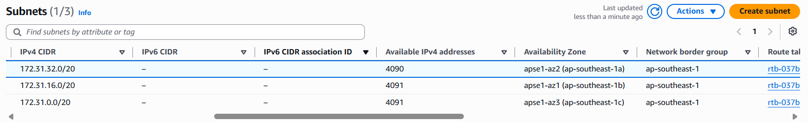
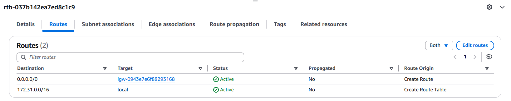
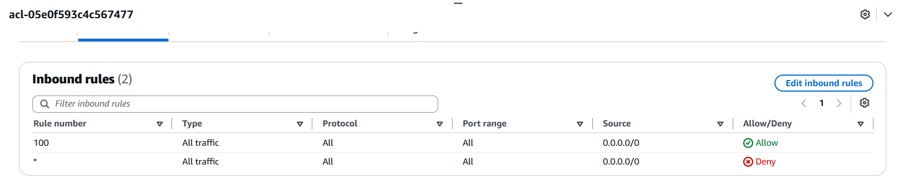
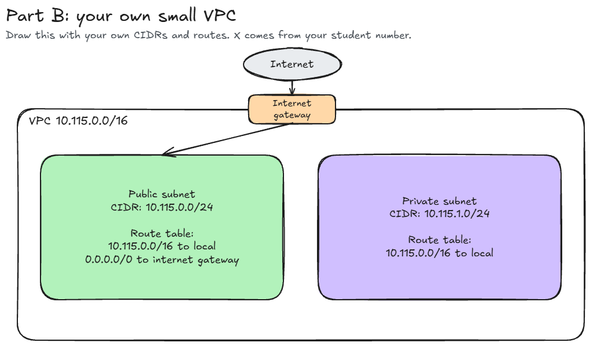

# Assignment 2 Submission

<!--
How to use this template:

1. Copy this file to submissions/assignment-2/<your-github-username>/submission.md
2. Replace every answer placeholder with your own answer. Delete the angle brackets too.
3. Save your four images in the same folder, with the exact file names below.
4. Do not write your full name or your student number in this file.
-->

## About me

- GitHub username: rssnjade
- Section: IV-CCSAD
- IAM user name that I signed in with: ccsad-g02
- X: 115

---

## Part A. Explore

### A1. The VPC

Default VPC IPv4 CIDR:

172.31.0.0/16

Number of addresses in that CIDR:

65,536

### A2. The subnets

| Availability Zone | IPv4 CIDR |
| --- | --- |
| apse1-az2 (ap-southeast-1a) | 172.31.32.0/20 |
| apse1-az1 (ap-southeast-1b) | 172.31.16.0/20 |
| apse1-az3 (ap-southeast-1c) | 172.31.0.0/20 |

Screenshot 1. Save it as `screenshot-1-subnets.png` in your folder. The image line below shows it.

### A3. Available addresses

Available IPv4 addresses in each subnet:

ap-southeast-1a: 4,090 
ap-southeast-1b: 4,091 
ap-southeast-1c: 4,091

Why is the number lower than 4,096?

AWS reserves 5 IPv4 addresses in every subnet, so a /20 subnet normally has 4,091 usable addresses instead of all 4,096.

What uses the missing address in the subnet with the lowest number?

The missing address is being used by the network interface of an EC2 instance in the subnet.

### A4. The route table

| Destination | Target |
| --- | --- |
| 172.31.0.0/16 | local |
| 0.0.0.0/0 | igw-... |

Screenshot 2. Save it as `screenshot-2-routes.png` in your folder. The image line below shows it.

### A5. Public or private

Are the default subnets public or private? Which route proves it?

The default subnets are public because the route 0.0.0.0/0 points to the internet gateway (igw-...). This gives the subnets a route to the internet.

### A6. The internet gateway

State of the internet gateway:

Attached

What happens to the default subnets if the gateway is detached?

If the internet gateway is detached, the default subnets will lose their connection to the internet because the 0.0.0.0/0 route no longer has a working internet gateway as its target.

### A7. NAT gateways

Number of NAT gateways:

0

Can a server in a new private subnet download updates? Why?

No. A private subnet does not have a direct route to the internet, and since there is no NAT gateway, the server has no way to reach the internet to download updates.

### A8. The network ACL

| Rule number | Source | Allow or Deny |
| --- | --- | --- |
| 100 | 0.0.0.0/0 | Allow |
| * | 0.0.0.0/0 | Deny |

How is a network ACL different from a security group?

A network ACL acts like a perimeter gate for an entire subnet, while a security group acts like a firewall for an individual resource such as an EC2 instance. Network ACLs are stateless and can allow or deny traffic, while security groups are stateful and use allow rules only.

Screenshot 3. Save it as `screenshot-3-network-acl.png` in your folder. The image line below shows it.

### A9. The default security group

Inbound rule (type and source):

All Traffic, source: sg-...

Which resources can send traffic to an instance that uses it?

Resources that also use the same default security group can send traffic to the instance.

---

## Part B. Prepare

### B1. Plan two subnets

- Public subnet CIDR: 10.115.0.0/24
- Private subnet CIDR: 10.115.1.0/24

### B2. Route tables

Route table of the public subnet:

| Destination | Target |
| --- | --- |
| 10.115.0.0/16 | local |
| 0.0.0.0/0 | internet gateway |

Route table of the private subnet:

| Destination | Target |
| --- | --- |
| 10.115.0.0/16 | local |

### B3. My VPC diagram

Tool used (Excalidraw, draw.io, Lucidchart, or paper):

Excalidraw

Save your diagram as `vpc-diagram.png` in your folder. The image line below shows it.

### B4. Predict a change

Can you still open the web page from your laptop? Why?

No, because the laptop is on the internet. If the 0.0.0.0/0 route is deleted, the instance loses its route to the internet, so the laptop cannot reach its web page.

Can the instance still reach another instance in the VPC? Why?

Yes, because the local route still connects the instances inside the same VPC.

### B5. Place a database

Which subnet gets the database? Why?

The database should be placed in the private subnet because it contains important data and should not be directly exposed to the internet.

### B6. My question about VPCs

What is your question, and what made you think of it?

Can two VPCs in different AWS Regions communicate with each other? I thought of this because the activity only showed a VPC inside one Region.