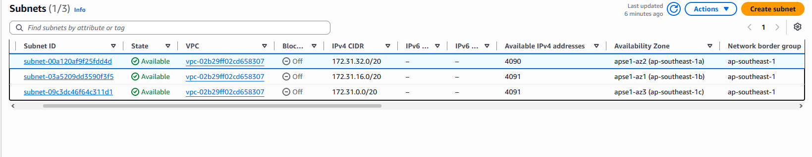
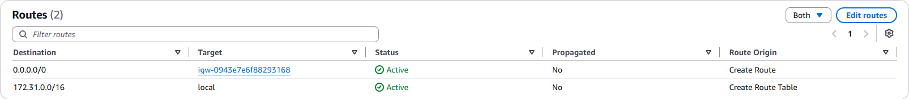
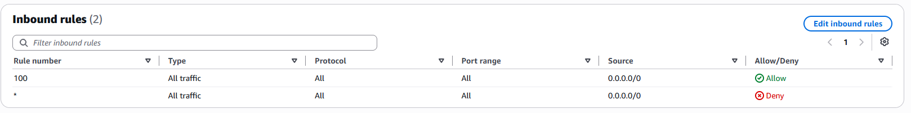
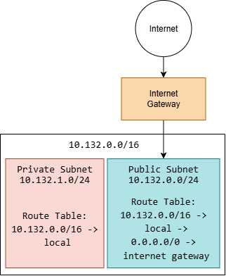

# Assignment 2 Submission

<!--
How to use this template:

1. Copy this file to submissions/assignment-2/<your-github-username>/submission.md
2. Replace every answer placeholder with your own answer. Delete the angle brackets too.
3. Save your four images in the same folder, with the exact file names below.
4. Do not write your full name or your student number in this file.
-->

## About me

- GitHub username: NathanielCamachoUMAK
- Section: III-CCSAD
- IAM user name that I signed in with: ccsad-g01
- X: 132

---

## Part A. Explore

### A1. The VPC

Default VPC IPv4 CIDR:

172.31.0.0/16

Number of addresses in that CIDR:

65,536

### A2. The subnets

| Availability Zone | IPv4 CIDR |
| --- | --- |
| ap-southeast-1a | 172.31.32.0/20 |
| ap-southeast-1b | 172.31.16.0/20 |
| ap-southeast-1c | 172.31.0.0/20 |

Screenshot 1. Save it as `screenshot-1-subnets.png` in your folder. The image line below shows it.

### A3. Available addresses

Available IPv4 addresses in each subnet:

4090, 4091, 4091

Why is the number lower than 4,096?

AWS always reserves 5 IP addresses in every subnet for its own internal networking and routing.

What uses the missing address in the subnet with the lowest number?

<answer>

### A4. The route table

| Destination | Target |
| --- | --- |
| 0.0.0.0/0 | igw-0943e7e6f88293168 |
| 172.31.0.0/16 | local |

Screenshot 2. Save it as `screenshot-2-routes.png` in your folder. The image line below shows it.

### A5. Public or private

Are the default subnets public or private? Which route proves it?

Public, the route 0.0.0.0/0 sends traffic to the internet gateway

### A6. The internet gateway

State of the internet gateway:

Attached

What happens to the default subnets if the gateway is detached?

The route 0.0.0.0/0 loses its working target, removing the subnets' path to the internet. The instances can still reach each other via the local route

### A7. NAT gateways

Number of NAT gateways:

0

Can a server in a new private subnet download updates? Why?

No, a new private subnet uses a route table with only the local route

### A8. The network ACL

| Rule number | Source | Allow or Deny |
| --- | --- | --- |
| 100 | 0.0.0.0/0 | Allow |
| * | 0.0.0.0/0 | Deny |

How is a network ACL different from a security group?

A network ACL acts as a firewall that protects an entire subnet, whereas a security group protects individual resources like instances and can specifically deny traffic, while a security group is stateful and can only allow traffic

Screenshot 3. Save it as `screenshot-3-network-acl.png` in your folder. The image line below shows it.

### A9. The default security group

Inbound rule (type and source):

All traffic - sg-0c5b6d4081cf0a534 / default

Which resources can send traffic to an instance that uses it?

Only resources that also use the default security group

---

## Part B. Prepare

### B1. Plan two subnets

- Public subnet CIDR: 10.132.0.0/24
- Private subnet CIDR: 10.132.1.0/24

### B2. Route tables

Route table of the public subnet:

| Destination | Target |
| --- | --- |
| 10.132.0.0/16 | local |
| 0.0.0.0/0 | internet gateway |

Route table of the private subnet:

| Destination | Target |
| --- | --- |
| 10.132.0.0/16 | local |

### B3. My VPC diagram

Tool used draw.io:

Yes, The local route for the VPC range is still in the route table, which connects every subnet in the VPC

Save your diagram as `vpc-diagram.png` in your folder. The image line below shows it.

### B4. Predict a change

Can you still open the web page from your laptop? Why?

No, The laptop is on the internet, and without the route 0.0.0.0/0, traffic between the instance and an internet address has no route, even with a public IP address

Can the instance still reach another instance in the VPC? Why?

Yes, the local route for the VPC range is still in the route table, which connects every subnet in the VPC

### B5. Place a database

Which subnet gets the database? Why?

The private subnet, 10.132.1.0/24. Its route table has no route to the internet gateway, so nobody on the internet can reach the database

### B6. My question about VPCs

What is your question, and what made you think of it?

How do developers or administrators securely connect to and manage a database if it is placed in a private subnet with no internet access? I thought of this because if the private subnet has no route to the internet gateway, I am not sure how a database administrator working from their own laptop on a home network would log in to run queries, update schemas, or perform maintenance.