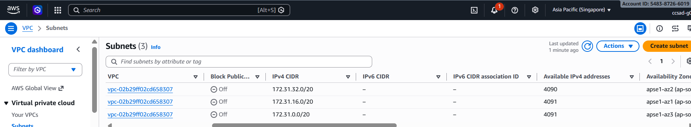
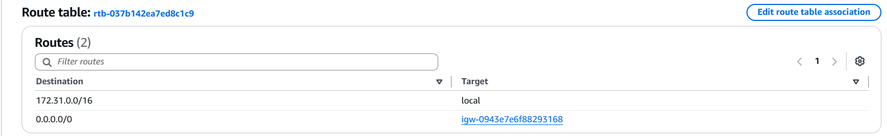
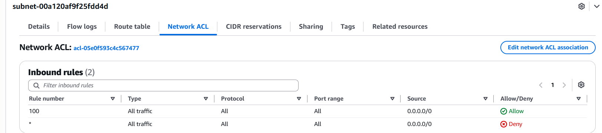
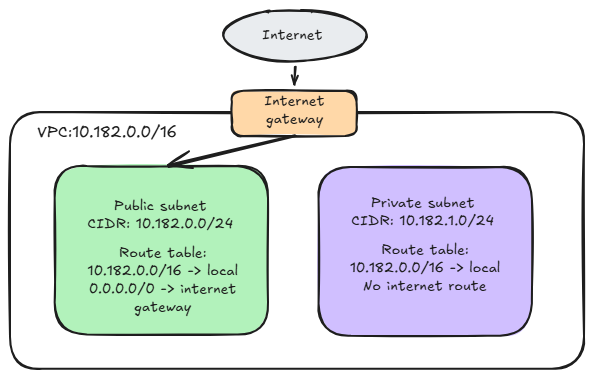

# Assignment 2 Submission

<!--
How to use this template:

1. Copy this file to submissions/assignment-2/<your-github-username>/submission.md
2. Replace every answer placeholder with your own answer. Delete the angle brackets too.
3. Save your four images in the same folder, with the exact file names below.
4. Do not write your full name or your student number in this file.
-->

## About me

- GitHub username: yajiiiii
- Section: IV-CCSAD
- IAM user name that I signed in with: ccsad-g03
- X: 182

---

## Part A. Explore

### A1. The VPC

Default VPC IPv4 CIDR:

172.31.0.0/16

Number of addresses in that CIDR:

 65,536

### A2. The subnets

| Availability Zone | IPv4 CIDR |
| --- | --- |
| ap-southeast-1a | 172.31.32.0/20 |
| ap-southeast-1b | 172.31.16.0/20 |
| ap-southeast-1c | 172.31.0.0/20  |

Screenshot 1. Save it as `screenshot-1-subnets.png` in your folder. The image line below shows it.

### A3. Available addresses

Available IPv4 addresses in each subnet:

| Availability Zone | IPv4 CIDR	| Available IPv4 addresses |
| --- | --- | --- |
| ap-southeast-1a |	172.31.32.0/20 | 4,090 |
| ap-southeast-1b |	172.31.16.0/20 | 4,091 |
| ap-southeast-1c |	172.31.0.0/20 |  4,091 |

Why is the number lower than 4,096?

Each /20 subnet contains 4,096 IPv4 addresses, but AWS reserves 5 addresses for networking purposes, leaving 4,091 usable addresses.

What uses the missing address in the subnet with the lowest number?

The extra missing address is assigned to a resource in ap-southeast-1a, typically an EC2 instance’s private IPv4 address on its network interface. This reduces the available addresses from 4,091 to 4,090.

### A4. The route table

| Destination | Target |
| --- | --- |
| 172.31.0.0/16 | local |
| 0.0.0.0/0 | igw-... |

Screenshot 2. Save it as `screenshot-2-routes.png` in your folder. The image line below shows it.

### A5. Public or private

Are the default subnets public or private? Which route proves it?

The default subnets are public. Because the route 0.0.0.0/0 → igw-... directs internet traffic to the internet gateway.

### A6. The internet gateway

State of the internet gateway:

The internet gateway is attached to the default VPC.

What happens to the default subnets if the gateway is detached?

If the internet gateway is detached, the default subnets lose their connection to the internet. Instances can still communicate within the VPC through the local route.

### A7. NAT gateways

Number of NAT gateways:

0 The class account has no NAT gateways.

Can a server in a new private subnet download updates? Why?

No, a server in a new private subnet cannot download updates from the internet because the class account has no NAT gateway to provide outbound internet access.

### A8. The network ACL

| Rule number | Source | Allow or Deny |
| --- | --- | --- |
| 100 | 0.0.0.0/0 | Allow |
| * | 0.0.0.0/0 | Deny |

How is a network ACL different from a security group?

A network ACL applies to an entire subnet, supports allow and deny rules, and is stateless, so each traffic direction needs its own rule. A security group applies to a resource, supports only allow rules, and is stateful, so replies to allowed traffic are automatically permitted.

Screenshot 3. Save it as `screenshot-3-network-acl.png` in your folder. The image line below shows it.

### A9. The default security group

Inbound rule (type and source):

Type: All traffic. Source: the same default security group (a self-referencing rule).

Which resources can send traffic to an instance that uses it?

Resources associated with the same default security group can send traffic to the instance using private IP addresses. This rule does not allow traffic from other sources.

---

## Part B. Prepare

### B1. Plan two subnets

- Public subnet CIDR: 10.182.0.0/24
- Private subnet CIDR: 10.182.1.0/24

### B2. Route tables

Route table of the public subnet:

| Destination | Target |
| --- | --- |
| 10.182.0.0/16 | local |
| 0.0.0.0/0 | internet gateway |

Route table of the private subnet:

| Destination | Target |
| --- | --- |
| 10.182.0.0/16 | local |

### B3. My VPC diagram

Tool used (Excalidraw, draw.io, Lucidchart, or paper):

Excalidraw

Save your diagram as `vpc-diagram.png` in your folder. The image line below shows it.

### B4. Predict a change

Can you still open the web page from your laptop? Why?

No, I cannot open the web page from my laptop because deleting the 0.0.0.0/0 route removes the instance's route to the internet. Having a public IPv4 address alone is not enough.

Can the instance still reach another instance in the VPC? Why?

Yes, the instance can still reach another instance in the same VPC using its private IP address because the local route remains. The security groups and network ACLs must also allow the traffic.

### B5. Place a database

Which subnet gets the database? Why?

I would place the database in the private subnet, 10.182.1.0/24, because it has no route to the internet gateway. The application in the public subnet can reach the database through the local route, with security group rules controlling access.

### B6. My question about VPCs

What is your question, and what made you think of it?

How can instances in two different VPCs communicate securely? I thought of this because the local route only connects subnets within the same VPC.
